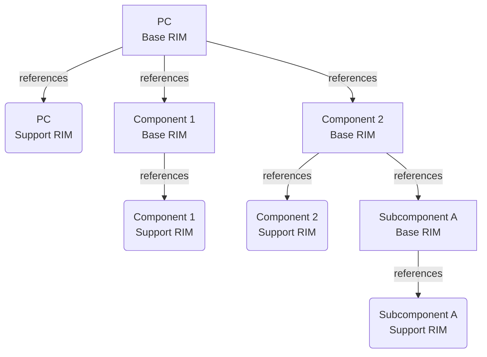

# Firmware Validation for a Composite RIM

A Composite RIM is a RIM Bundle that includes or references other Base RIM Instances in its payload element.

There may be scenarios in which multiple entities take part in the production of a given device. That 
in turn may lead the Verifier to retrieve multiple RIM Bundles in order to verify the device. Such a 
scenario may require a RIM Bundle associated with the device to include or provide references to other 
RIM Bundle(s) being managed by other entities.

Consider a modern PC manufacturer that includes components from various component vendors (e.g., 
disk drive, memory, CPUs, etc.). Each component vendor may have its own RIM that corresponds to 
firmware running on the component. The PC manufacturer may wish to include or reference a Component RIM 
in its own RIM without corrupting the original component RIM’s signature. The PC manufacturer may also 
want its own signature on the RIM to include coverage of all the Component RIMs. The inclusion of 
Component RIM reference within a PC manufacturers RIM is illustrated in the following:

Rectangles represent Base RIMs; rounded nodes represent Support RIMs. Arrows show references, including the reference from Component 2's Base RIM to Subcomponent A's Base RIM.

!!! note

    The `RIM-Tool` processes one Base RIM at a time. Each PC Base RIM or Component RIM must be created or verified one at a time.
